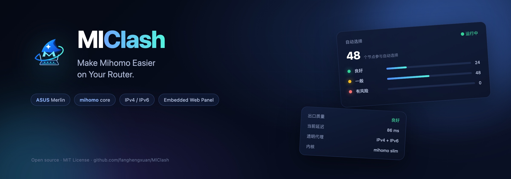
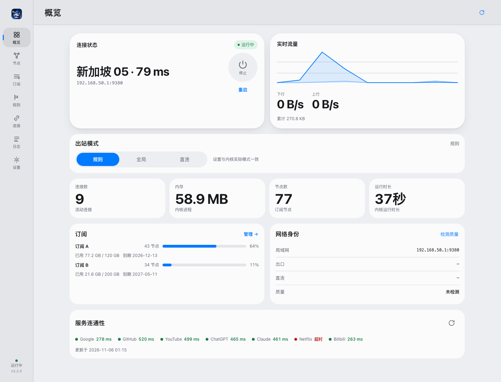
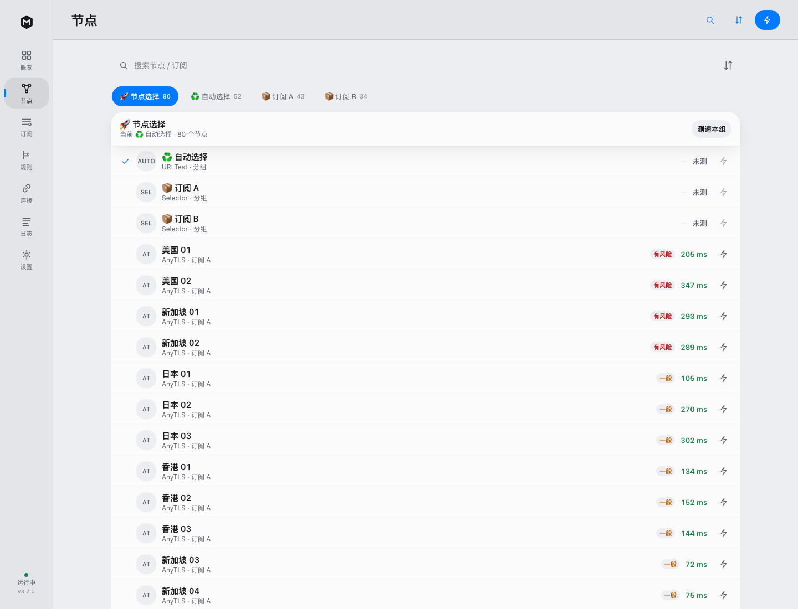
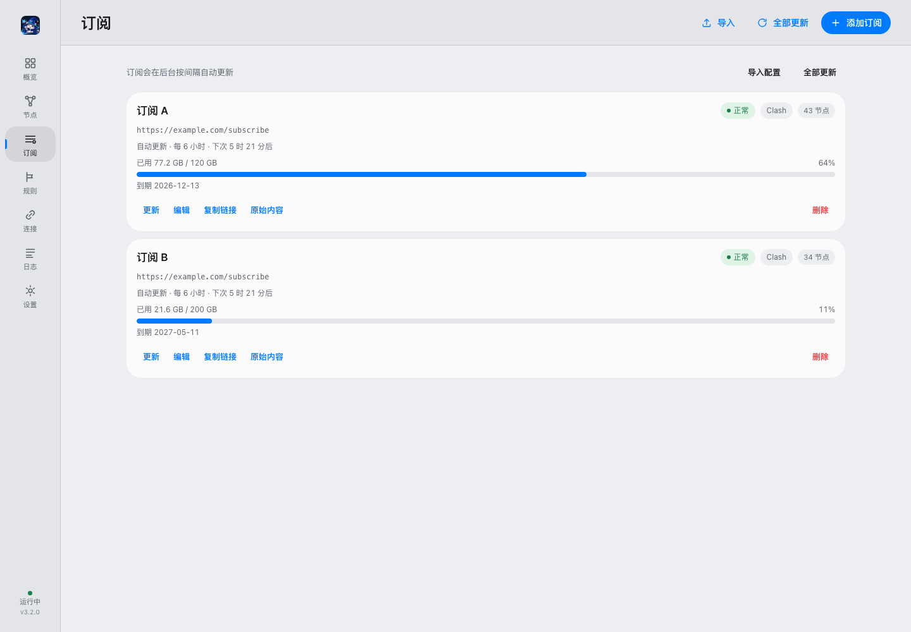
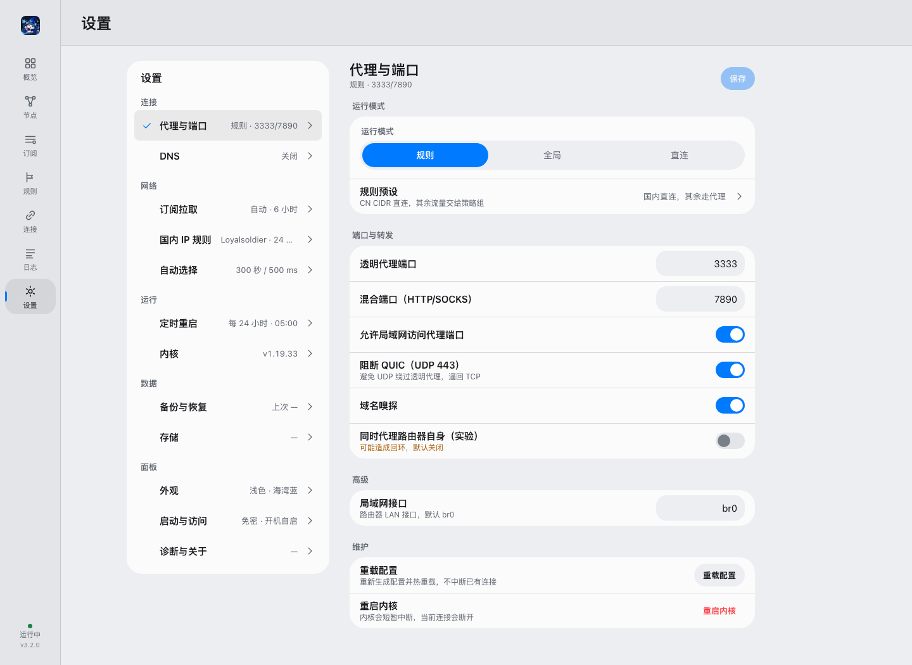

<p align="center">
  
</p>

<p align="center">
  <a href="https://github.com/fanghengxuan/MlClash/actions/workflows/ci.yml"></a>
  <a href="https://github.com/fanghengxuan/MlClash/releases"></a>
  <a href="LICENSE"></a>
</p>

<p align="center"><b>简体中文</b> · <a href="README_EN.md">English</a></p>

## 项目简介

**MlClash** 是运行在华硕路由器（Asuswrt-Merlin / gnuton 固件）上的 mihomo 代理插件。一个安装包里包含 mihomo slim 内核、IPv4/IPv6 透明代理和 Web 面板，不需要旁路由、Docker 或额外控制器：局域网设备连上 Wi-Fi 即走代理。

> 当前版本 **3.2.0**：新增节点出口质量检测，自动选择会排除被标记为代理 / VPN / Tor 的风险节点。详见 [CHANGELOG.md](CHANGELOG.md)。

## 核心功能

| 能力 | 说明 |
|---|---|
| **路由器级透明代理** | IPv4 与 IPv6 TCP 流量经 `iptables` / `ip6tables` REDIRECT 到 mihomo，LAN 设备零配置 |
| **订阅与节点** | 链接导入或粘贴配置，支持包含/排除正则、单订阅更新间隔、手动与 URL 测速分组 |
| **节点出口质量** | 订阅更新后后台探测出口 IP，标记「良好 / 一般 / 有风险」；自动选择排除风险节点 |
| **规则与分流** | `rule` / `global` / `direct` 三种模式；国内直连预设（GeoSite、可选 GeoIP、chnroute） |
| **去广告与 DNS** | 可选 anti-AD 列表（约 10 万条）；`redir-host` 或 `fake-ip` |
| **面板与运维** | 概览、节点、订阅、规则、连接、日志、设置；SSE 实时日志；内核更新与回滚；备份恢复；定时重启与看门狗 |

## 界面预览

<p align="center">
  <a href="docs/screenshots/overview.png"></a>
  <a href="docs/screenshots/nodes.png"></a>
  <br><sub>概览 · 节点</sub>
</p>
<p align="center">
  <a href="docs/screenshots/subs.png"></a>
  <a href="docs/screenshots/settings.png"></a>
  <br><sub>订阅 · 设置</sub>
</p>

## 支持环境

| 项目 | 状态 |
|---|---|
| 已验证设备 | **TUF-AX3000**（axhnd.675x / armv7 / 内核 4.1） |
| 已验证固件 | **gnuton Asuswrt-Merlin** |
| koolshare / SWRT | 安装包构建通过，**未在真机验证** |
| CPU 架构 | armv7（`GOARM=7`）；其他架构需自行交叉编译 |
| JFFS | 需启用自定义脚本；安装至少需要 **18 MB** 可用空间 |
| 内存 | 建议 512 MB 及以上 |
| 安装通道 | Merlin 原生安装需 SSH；koolshare 通过软件中心离线安装 |

> 上表只标注已验证的设备与固件。其他华硕 armv7 机型理论可用，但未逐台验证。

## 快速安装

**Asuswrt-Merlin / gnuton**

1. 从 [Releases](https://github.com/fanghengxuan/MlClash/releases) 下载 `MlClash_<版本>_armv7_merlin.tar.gz`。
2. 开启 **系统管理 → 系统设置 → Enable JFFS custom scripts and configs**。
3. 上传到路由器并安装：

```sh
cd /tmp
tar -xzf MlClash_<版本>_armv7_merlin.tar.gz
sh /tmp/MlClash/install.sh
```

4. 打开 `http://<路由器IP>:9380`，在「订阅」页添加订阅，在「概览」页启动引擎。

**koolshare / SWRT**：下载 `MlClash_<版本>_armv7_koolshare.tar.gz`，在软件中心离线安装。

> **安全提醒**：面板与 mihomo API 仅面向局域网使用，不要把 `9380` 或 `9090` 暴露到 WAN。建议在「设置 → 启动与访问」设置面板密码。

升级、卸载、端口与数据目录见 [docs/INSTALL.md](docs/INSTALL.md)。

## 文档导航

| 文档 | 内容 |
|---|---|
| [安装与卸载](docs/INSTALL.md) | 两种固件的安装、升级、卸载、首次配置、端口与数据目录 |
| [常见问题](docs/FAQ.md) | 面板打不开、内核未运行、节点质量未测、广告未拦截等 |
| [开发与构建](docs/DEVELOPMENT.md) | 从源码构建、测试、项目结构与版本同步 |
| [API 契约](docs/API.md) | 面板 HTTP 接口 |
| [内核说明](docs/kernel.md) | 随包 mihomo 的构建、体积与能力边界 |
| [更新日志](CHANGELOG.md) | 完整版本记录 |
| [贡献指南](CONTRIBUTING.md) | 提 Issue / PR 的要求 |
| [问题反馈](https://github.com/fanghengxuan/MlClash/issues) | Bug 报告与功能建议 |
| [English](README_EN.md) | 英文首页 |

## 开源协议

[MIT](LICENSE)。mihomo 为 GPL-3.0；GeoSite / GeoIP 数据来自 MetaCubeX/meta-rules-dat、anti-AD、Loyalsoldier 及其上游，第三方组件与数据遵循各自许可。
