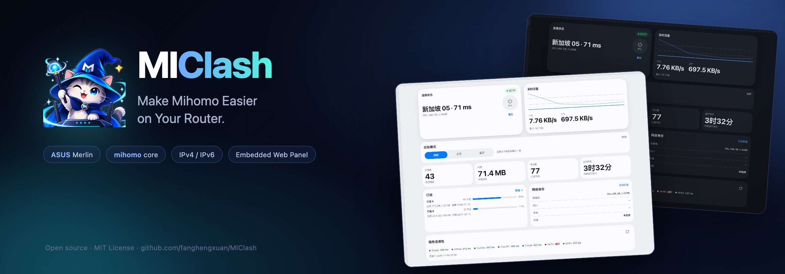

<p align="center">
  
</p>

<p align="center">
  <a href="https://github.com/fanghengxuan/MlClash/actions/workflows/ci.yml"></a>
  <a href="https://github.com/fanghengxuan/MlClash/releases"></a>
  <a href="LICENSE"></a>
</p>

<p align="center"><a href="README.md">简体中文</a> · <b>English</b></p>

## Overview

**MlClash** is a mihomo proxy plugin for ASUS Merlin routers (Asuswrt-Merlin / gnuton). One package bundles the mihomo slim core, transparent IPv4/IPv6 forwarding and a web panel. No side router, Docker container or external controller is required — LAN devices go through the proxy as soon as they join Wi-Fi.

> Current version **3.2.0**: adds node exit-IP quality checks; URL-test groups now exclude nodes flagged as proxy / VPN / Tor. See [CHANGELOG.md](CHANGELOG.md).

## Core features

| Capability | Details |
|---|---|
| **Router-level transparent proxy** | IPv4 and IPv6 TCP traffic redirected to mihomo via `iptables` / `ip6tables` REDIRECT; zero client setup |
| **Subscriptions & nodes** | URL import or pasted config, include/exclude regex, per-subscription intervals, manual and URL-test groups |
| **Exit IP quality** | After each subscription refresh, exit IPs are probed in the background and labeled Good / Normal / Risky; URL-test groups exclude risky nodes |
| **Rules & routing** | `rule` / `global` / `direct` modes; China-direct preset (GeoSite, optional GeoIP, chnroute) |
| **Ad blocking & DNS** | Optional anti-AD list (~100k domains); `redir-host` or `fake-ip` |
| **Panel & operations** | Overview, nodes, subscriptions, rules, connections, logs and settings; SSE logs; kernel update and rollback; backup/restore; scheduled restart and watchdog |

## Screenshots

<p align="center">
  <a href="docs/screenshots/overview-light.png?v=3"></a>
  <a href="docs/screenshots/nodes-light.png?v=3"></a>
  <br><sub>Overview · Nodes</sub>
</p>
<p align="center">
  <a href="docs/screenshots/subs-light.png?v=3"></a>
  <a href="docs/screenshots/settings-light.png?v=3"></a>
  <br><sub>Subscriptions · Settings</sub>
</p>

## Requirements

| Item | Status |
|---|---|
| Verified device | **TUF-AX3000** (axhnd.675x / armv7 / kernel 4.1) |
| Verified firmware | **gnuton Asuswrt-Merlin** |
| koolshare / SWRT | Package builds, **not verified on hardware** |
| CPU | armv7 (`GOARM=7`); other architectures require cross-compiling |
| JFFS | Custom scripts enabled; at least **18 MB** free |
| RAM | 512 MB or more recommended |
| Installation | SSH for the Merlin installer; software center for koolshare |

> Only the device and firmware above are marked as verified. Other ASUS armv7 models should work in theory but have not been tested individually.

## Quick start

**Asuswrt-Merlin / gnuton**

1. Download `MlClash_<version>_armv7_merlin.tar.gz` from [Releases](https://github.com/fanghengxuan/MlClash/releases).
2. Enable **Administration → System → Enable JFFS custom scripts and configs**.
3. Upload to the router and install:

```sh
cd /tmp
tar -xzf MlClash_<version>_armv7_merlin.tar.gz
sh /tmp/MlClash/install.sh
```

4. Open `http://<router-ip>:9380`, add a subscription under **Subscriptions**, then start the engine from **Overview**.

**koolshare / SWRT**: download `MlClash_<version>_armv7_koolshare.tar.gz` and install it offline from the software center.

> **Security**: the panel and mihomo API are intended for LAN use. Do not expose `9380` or `9090` to the WAN. Set a panel password under **Settings → Startup & access**.

Upgrade, uninstall, ports and data directories: [docs/INSTALL.md](docs/INSTALL.md).

## Documentation

| Document | Contents |
|---|---|
| [Install & uninstall](docs/INSTALL.md) | Install, upgrade, uninstall, first-run setup, ports and data directories |
| [FAQ](docs/FAQ.md) | Panel unreachable, engine not running, quality untested, ads still visible |
| [Development](docs/DEVELOPMENT.md) | Building from source, tests, project layout, version sync |
| [API contract](docs/API.md) | Panel HTTP API |
| [Kernel notes](docs/kernel.md) | Bundled mihomo build, size and capability limits |
| [Changelog](CHANGELOG.md) | Full version history |
| [Contributing](CONTRIBUTING.md) | Issue / PR requirements |
| [Issues](https://github.com/fanghengxuan/MlClash/issues) | Bug reports and feature requests |
| [简体中文](README.md) | Chinese homepage |

Detailed documentation is currently written in Chinese.

## License

[MIT](LICENSE). mihomo is GPL-3.0. GeoSite / GeoIP data comes from MetaCubeX/meta-rules-dat, anti-AD, Loyalsoldier and their upstream sources. Third-party components and data remain under their respective licenses.
